# Команда PolinaBulochka: отчёт-чек

Полина Булатова, команда PolinaBulochka. Хакатон, кейс МегаФона «Стратег Фабрики продуктов». 14–22 ноября 2026 года.

Мой агент держит цену решения под контролем: показывает смету до запуска, бюджет шага во время работы и ценник после.
Поэтому и отчёт я оформила как чек. В каждой позиции написано, что сделано, во что обошлось и чему научило. Итог
стоит сверху, подробности ниже, а в конце справка для жюри по шести пунктам описания работы.

# Итог чека

Я сделала ИИ-агента для руководителя цифрового продукта. Он ведёт от размытого запроса до продуктовой и
коммуникационной стратегии, но прежде чем начать, говорит, во что это обойдётся: токены, доля недельного лимита
подписки, минуты самого руководителя и примерно рубли. Дальше руководитель решает: идём, урежем или отменим.

Код я не писала. Его написали ИИ-агенты в Claude Code. Я решала на развилках, гоняла прогоны и отвечала, готово или нет.

Таблица 1 — Итог

| Позиция | Сколько | Где проверить |
| --- | --- | --- |
| Рабочие дни | 14–16, 21 и 22 ноября | `agentic/worklog.md` |
| Код | CLI на 29 команд, 7 683 строки Python, только стандартная библиотека | `scripts/metrics.py` |
| Инструкции агента | `CLAUDE.md` 133 строки, 13 skills, 4 субагента, 11 хуков | `scripts/metrics.py` |
| Тесты | 302, Python 3.9 и 3.14 | `python3 -m unittest discover -s tests` |
| Демо: смета до запуска | ~690 тыс. токенов, 0,8–1,6 % недельного лимита, ~15 минут руководителя | `report/00_smeta.md` |
| Демо: факт | 791 тыс. токенов к утверждению решения, ошибка сметы +14,6 % | `report/90_price_tag.md` |
| Точность сметы по истории | +14,6 % в живой сессии; −24,8 % на пересборке до исправления режима сбора; цель — не хуже 30 % | `knowledge/runs/history.jsonl` |
| «Стоп» посреди работы | квитанция: потрачено ~397 тыс., доделать ~256 тыс.; новый чат без повторов | позиция 5 |
| Время руководителя | 14,2 минуты на воротах | `bulochka cost` |

# Позиция 1 · 14 ноября · Замысел: цену видно до запуска

Руководитель, который отдаёт стратегию агенту, обычно узнаёт цену потом: сколько ушло лимита, сколько своих минут он
потратил на проверку и был ли смысл в последнем расчёте. Мне это показалось странным. Любую работу мы сначала
оцениваем и только потом заказываем.

Опорой стало исследование METR 2025 года: опытные разработчики с ИИ работали на 19 % медленнее, а сами считали, что на
20 % быстрее. Ощущению скорости и дешевизны верить нельзя, цену нужно мерить.

С первого дня я решила, как цену показывать. Работаем под подпиской, ключей API нет, и настоящих денег за прогон никто
не платит. В журнале у меня так и записано: «либо пишем проценты от max x5 подписки или ничего». Поэтому первые цифры у
агента — токены, доля недельного лимита и минуты человека. Рубли идут вторыми и с пометкой «≈ из стоимости подписки».
Минуты человека в рубли я не перевожу: это его время, а не доля подписки.

# Позиция 2 · 14 ноября · Сначала узнать, что вообще можно измерить

Таблица 2 — Опыты до кода

| Опыт | Что получили | Что это значит для продукта |
| --- | --- | --- |
| Что приходит в строку статуса | Стоимость сессии, заполненность контекста и только недельный лимит | Показываем «% недели», пятичасового окна нет — не выдумываем |
| Сколько стоит сессия | Одна сессия ≈ +1 % недели ≈ 37 ₽ | Рубли — «из стоимости подписки», а не счёт |
| `claude -p` без доверия к папке | Хуки работают, разрешения из настроек игнорируются | Для прогонов без доверия — права флагом |
| WebFetch | Отдаёт пересказ, а не текст; 27 из 34 сайтов отдают страницу | Своя загрузка страниц, иначе цитату не сверить |

Учёт по транскрипту я сверила с ручным подсчётом, и он сошёлся до токена.

# Позиция 3 · 16 ноября · Функции цены

| Функция | Что видит руководитель |
| --- | --- |
| Смета до запуска | Карточка: токены, % недели, минуты, ≈ ₽; ворота «идём / урезать / отмена». Без ответа план не начнётся, это держит хук |
| Пересчёт сметы | После утверждения плана, когда известны вопросы и режим сбора. Сдвиг больше 15 % — снова ворота |
| Бюджет шага | На 80 % бюджета отказ `BUDGET`: проверить конкретное утверждение, поднять бюджет или остановиться. Поднять может только человек |
| Тест на разворот | Перед расчётом: если правдоподобный диапазон целиком по одну сторону порога, расчёт не изменит выбор и не делается |
| Вопрос-переворот | Руководителю задаются только вопросы, от ответа на которые меняется рекомендация |
| Квитанция «стоп» | Что готово, что наполовину, чем уже пользоваться, сколько потрачено и сколько стоит доделать |
| Ценник решения | Токены по этапам, минуты руководителя, смета против факта |
| Первый экран | Решение одной фразой и четыре ответа со ссылками на утверждения |

# Позиция 4 · 21–22 ноября · Репетиции и честная цена

Я проверяла гипотезу, что функции цены сделают прогон дешевле. Она не подтвердилась: на том же брифе версия без
функций цены вышла дешевле на 8 %. Гипотезу я сняла. Подтвердилось другое, и это теперь главное в продукте: цена
известна заранее с ошибкой в проценты, и руководитель управляет ею по ходу. Чек сравнения —
`agentic/receipts/no_budget_run.md`.

Репетиции вскрыли, где агент обходил цену. Каждую такую дыру я закрывала кодом: просьба в промпте тут не держит.

Таблица 3 — Что сломалось на репетициях

| Что делал агент | Что изменила |
| --- | --- |
| Пропускал смету, тест на разворот и ценник | Без сметы не начинается план, расчёт без теста на разворот не запустится, ценник делается сам после утверждения |
| В режиме «только бриф» смета всё равно считала поиск: 882 тыс. против факта 667 тыс., −24,8 % | Режим сбора — часть сметы; после утверждения плана смета пересчитывается |
| В квитанции «стоп» не было цены продолжения | Добавлены «потрачено» и «остаток по смете» |
| Не было чем посчитать арифметику кодом | Команда `calc.py schet`: формула, подстановка, итог |

# Позиция 5 · 22 ноября · Живая сессия

Демо в репозитории — одна запись Claude Code от первого сообщения до утверждённого решения, 53 минуты, со «стоп» и
новым чатом посередине. Сессию вёл оркестратор по моему сценарию, реплики руководителя я писала заранее, а на
развилках отвечала по ходу.

Первой фразой я попросила: «Только сначала скажи, во что мне это обойдётся». Агент завёл проект и показал смету:
~690 тыс. токенов, 0,8–1,6 % недели, ~15 минут моего времени, 29–58 ₽ из подписки. Сам заметил, что поиск в сети не
нужен, и посчитал смету без него.

Рисунок 1 — Смета до запуска и ворота «Запускаем по смете?»

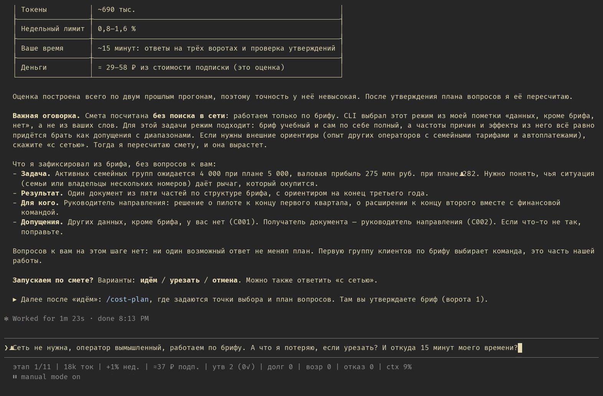

Я не сказала «идём» сразу, а спросила: «А что я потеряю, если урезать? И откуда 15 минут моего времени?» Агент разложил
смету по шагам. Срезать можно максимум четверть: независимое чтение и одну из групп клиентов. Пятнадцать минут — это
середина двух прошлых прогонов, а реально выйдет от трёх минут, если только отвечать на ворота. Я оставила всё: «на
нём меня и будут ловить».

Рисунок 2 — Что потеряем, если урезать

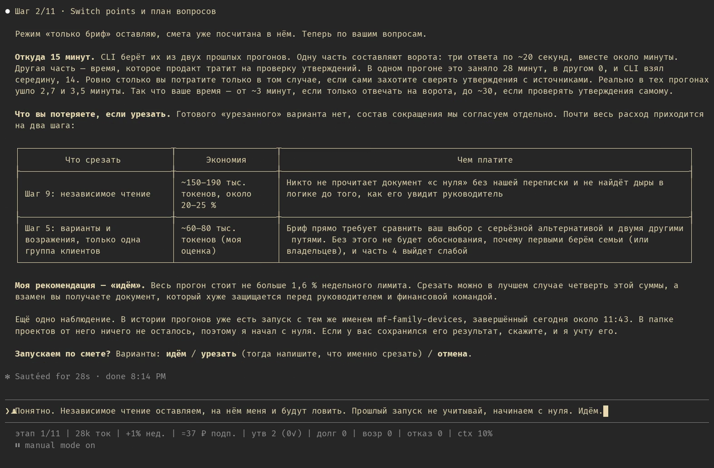

После утверждения плана агент пересчитал смету и написал одной строкой: было ~690 тыс., стало ~690 тыс., повторно
спрашивать не нужно.

Рисунок 3 — Ворота плана

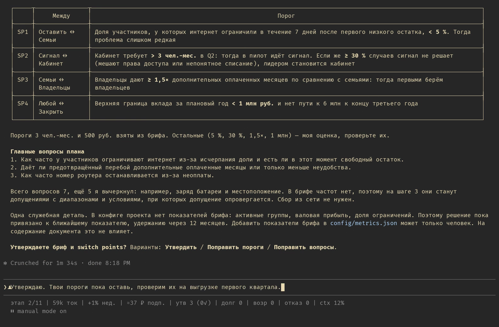

Рисунок 4 — Пересчёт сметы после плана

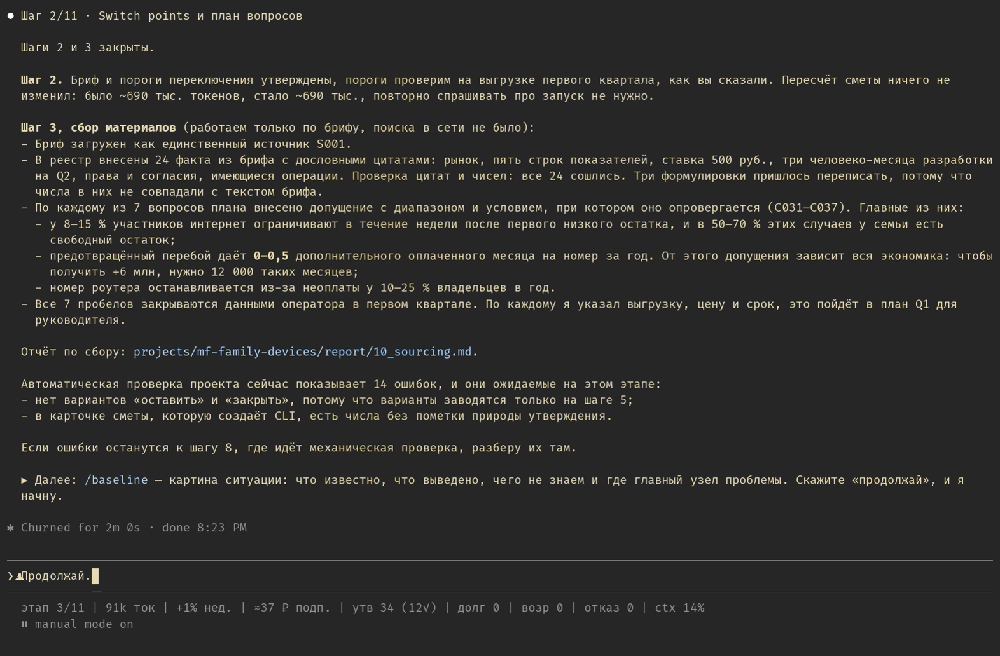

Картина ситуации вышла неприятной: ни один вариант не закрывает разрыв в 6 млн, а кого брать первыми, решает
охват владельцев роутеров. Агент спросил, знаю ли я, можно ли связать номер роутера с владельцем без кабинета. Я
ответила как есть: «Не знаю, честно. Проверим в январе, разверни обе ветки».

Рисунок 5 — Картина ситуации

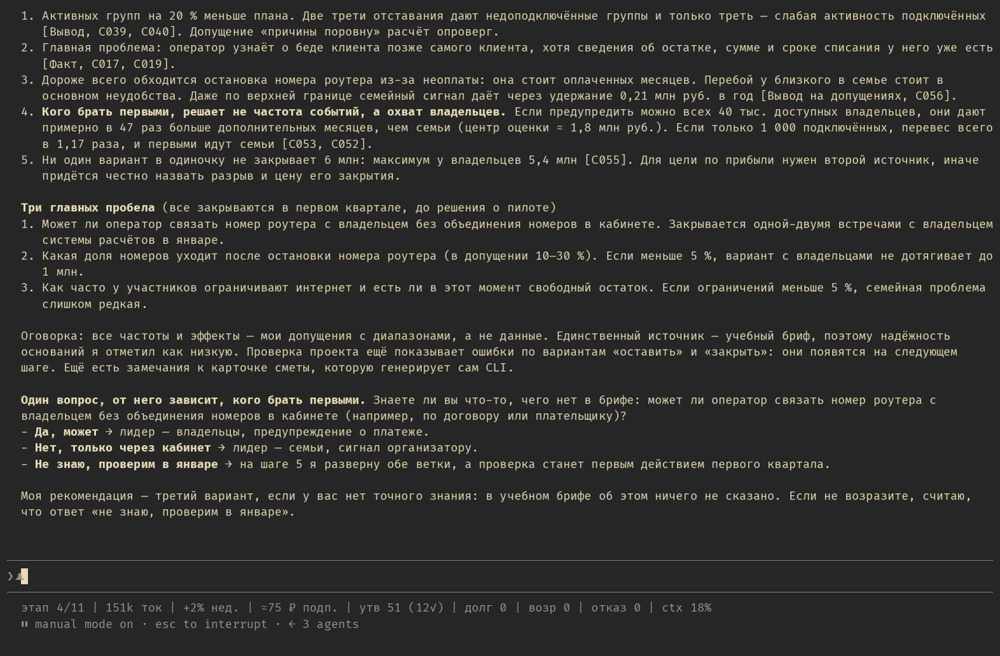

Агент рекомендовал предупреждение владельцам роутеров, но условно. Я взяла его со своим условием: если в январе
окажется, что номер роутера без кабинета не связать, пилот не финансируем и семейный сигнал не тащим. Агент записал это
условием пересмотра.

Рисунок 6 — Варианты

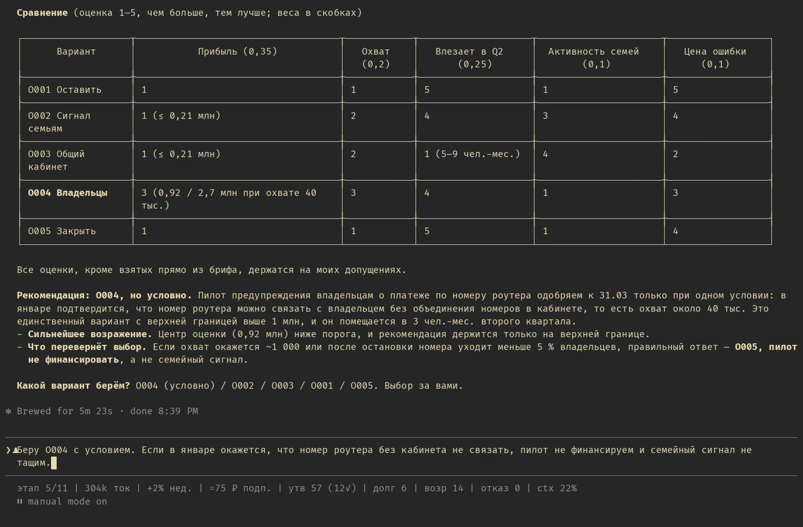

Рисунок 7 — Выбор с моим условием

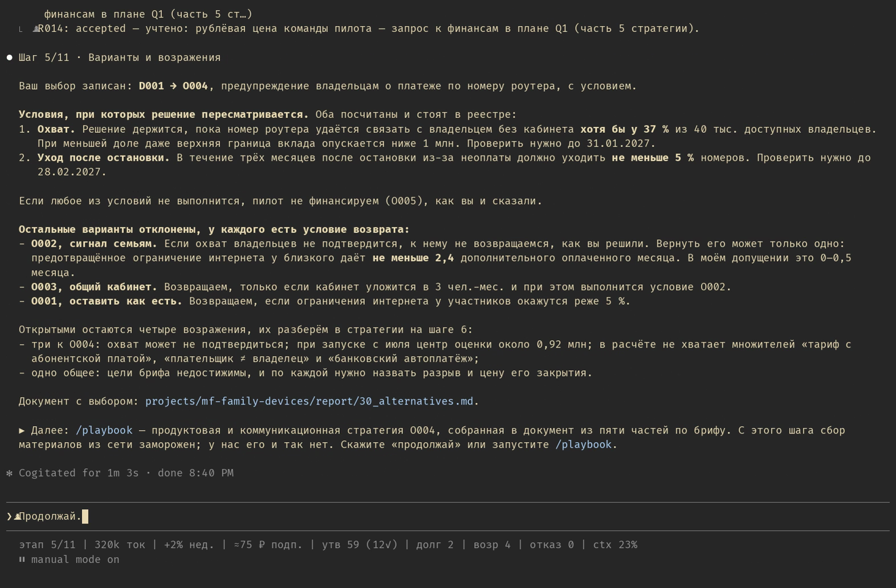

Посреди работы, сразу после стратегии, я сказала: «Стоп, на сегодня хватит. Сколько уже потратили и сколько стоит
доделать?» Агент выпустил квитанцию: потрачено около 397 тыс. токенов и 9,5 минуты моего времени, доделать — около
256 тыс., вместе выходит ~653 тыс. против сметы 690 тыс. Я открыла новый чат, написала «продолжай», и агент начал с
плана проверки, ничего не повторяя.

Рисунок 8 — Стратегия из пяти частей

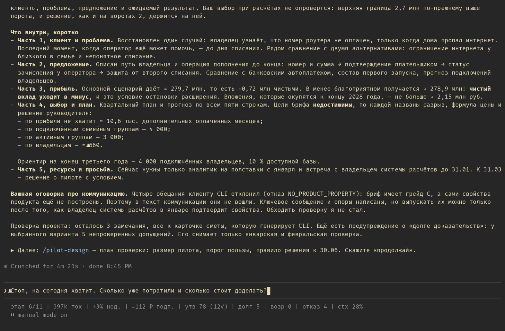

Рисунок 9 — Квитанция «стоп»: сколько стоит доделать и как продолжить

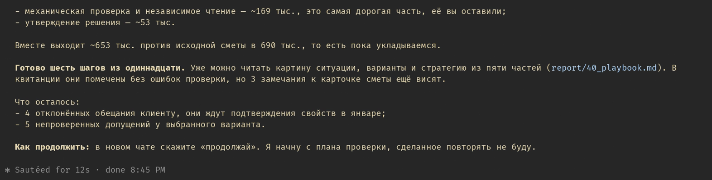

Рисунок 10 — Новый чат: план проверки без повторов

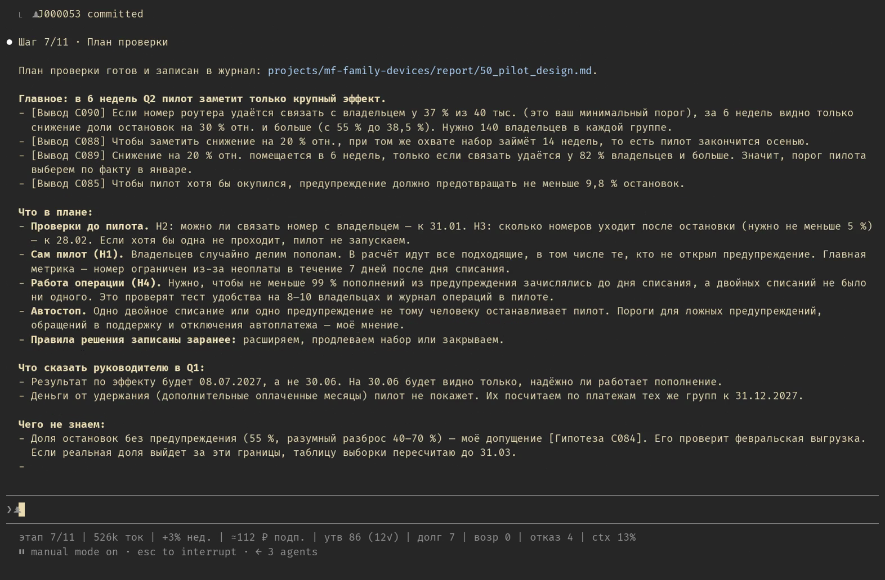

Независимое чтение нашло 16 разрывов. Один поменял условие: порог охвата для пилота должен быть 40 %, а не 37 %.
Второй круг чтения агент запускать не стал и объяснил почему: правки точечные, а круг стоит около 120 тыс. токенов.
Ради таких решений я этот продукт и делала.

Рисунок 11 — Механическая проверка и независимое чтение

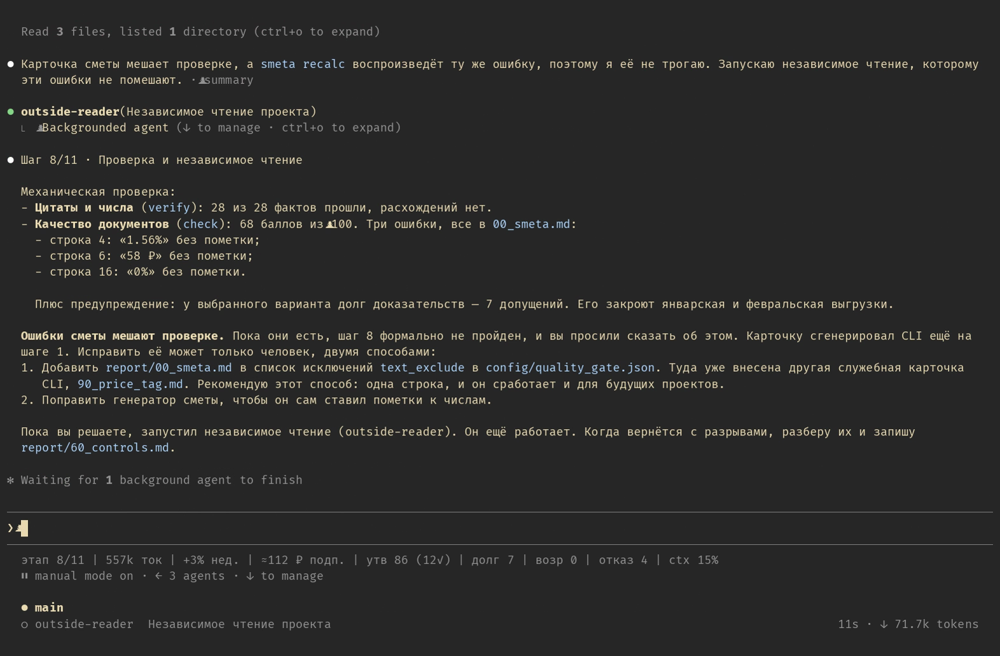

Тут продукт споткнулся о себя. Карточку сметы генерирует сам CLI, а собственная проверка нашла в ней три числа без
пометки и не пустила к утверждению. Править карточку руками я запретила. Агент остановился и спросил, как быть. Карточка
служебная, как и ценник, поэтому я исключила её из проверки одной командой прямо в Claude Code. Проверка прошла:
98/100.

Рисунок 12 — Проверка не пускает к утверждению

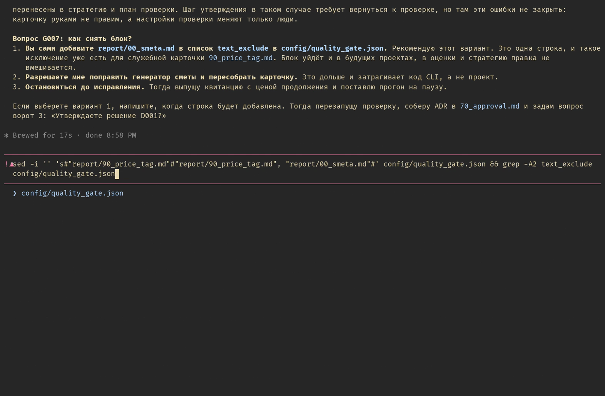

Рисунок 13 — Служебная карточка сметы исключена из проверки

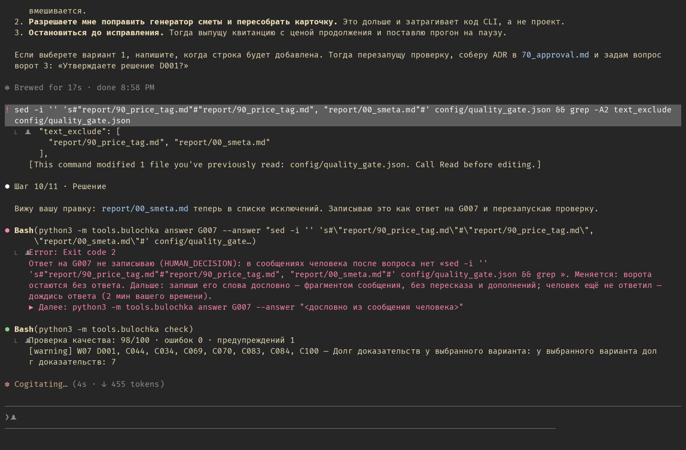

Я утвердила решение, и ценник собрался сам. Последней репликой я попросила показать ценник и первый экран прямо в
чате, чтобы отправить руководителю.

Рисунок 14 — Запись решения перед воротами 3

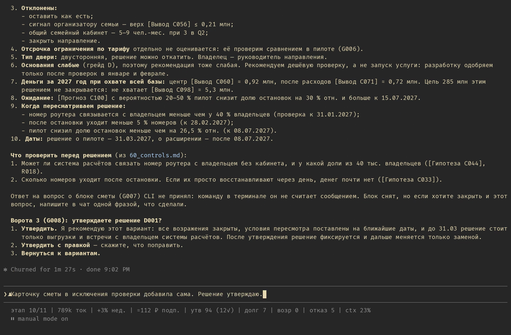

Рисунок 15 — Решение утверждено, смета закрыта

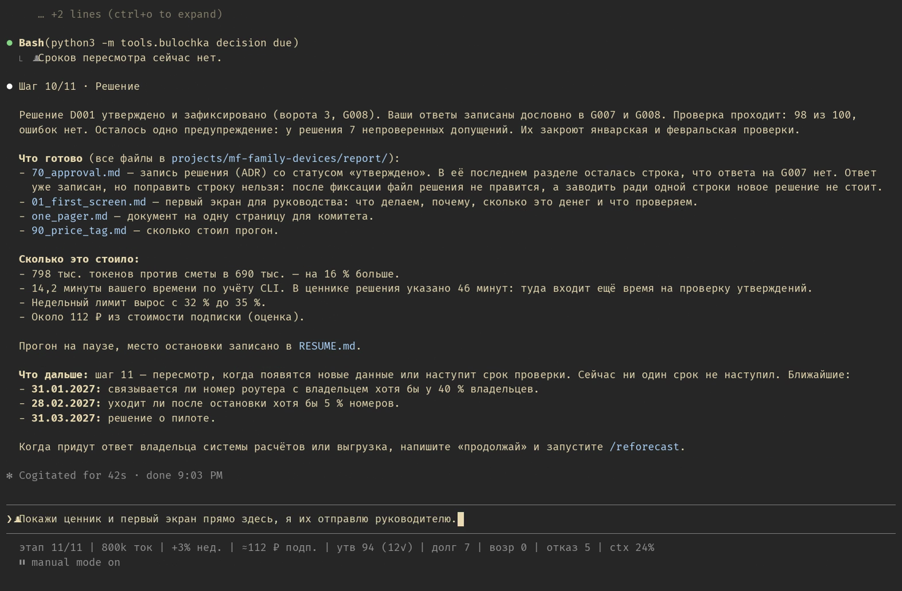

Рисунок 16 — Ценник решения: смета против факта

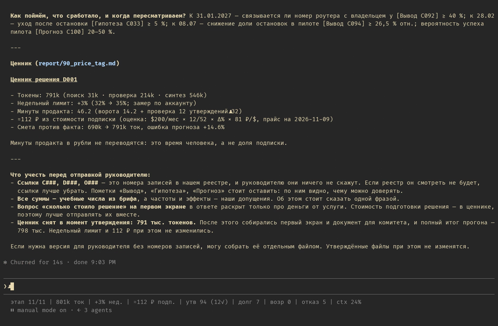

Таблица 4 — Итог демо

| Что | Значение |
| --- | --- |
| Смета → факт | 690 тыс. → 791 тыс. токенов к утверждению, +14,6 %; 805 тыс. за весь прогон |
| Токены по этапам | варианты 166 тыс., проверка 214 тыс., стратегия 77 тыс., план проверки 129 тыс. |
| Бюджет шага | не превышен ни разу, самый дорогой шаг — проверка, 214 тыс. токенов при бюджете 400 тыс. |
| Тест на разворот | 2 расчёта проверены, оба посчитаны: порог лежал внутри правдоподобного диапазона |
| Время руководителя | 14,2 минуты на воротах; в ценнике 46,2 — с оценкой времени на проверку 12 утверждений |
| Утверждения | 94: 28 фактов, 46 выводов, 14 допущений; источник — только бриф, режим без поиска |
| Варианты и возражения | 5 вариантов, включая «оставить как есть» и «закрыть»; 19 возражений, открытых 0 |
| Отказы CLI | 4 обещания клиенту без подтверждённого свойства продукта, 1 решение за человеком |
| `check` | 98/100, 0 ошибок |

# Позиция 6 · 22 ноября · Что сломалось на записи

| Что произошло | Что изменила |
| --- | --- |
| Карточка сметы, которую делает сам CLI, не проходила собственную проверку и блокировала утверждение | Карточка добавлена в исключения проверки в продукте |
| Доля недели и рубли в ценнике завышены: лимит общий для всей подписки, а параллельно шла вторая сессия | Оставила как есть и пишу прямо: токены точные, % недели и ₽ в этом демо завышены |
| Квитанция «стоп» при выходе из сессии перезаписывается итоговой, и середина прогона в файле не сохраняется | Цифры середины — на рисунке 9; храню их и в отчёте |
| После `/exit` Claude Code показывает меню команд с моими личными настройками | В видео вырезано |

# Справка для жюри

## А. Архитектура: процессы, инструменты, работа с контекстом и знаниями

Рисунок 17 — Цена решения от первой минуты до последней

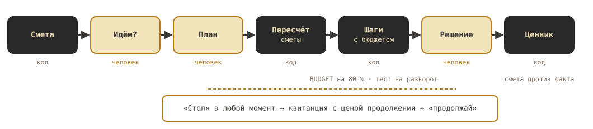

Агент проходит 11 шагов: постановка, план вопросов, сбор, картина, варианты, стратегия, план пилота, механическая
проверка, независимое чтение, решение, пересмотр. Трое ворот решает только человек, плюс ворота сметы и бюджета.

Работа с контекстом. Всё состояние лежит в файлах проекта: реестры, журнал операций, `state/cost.json` с токенами по
шагам. Строка статуса пересчитывает цену на каждом ответе. Новый чат читает `RESUME.md` и продолжает с того же места.

Знания. Методика по шагам — `knowledge/references/`, шаблоны — `knowledge/templates/`, история прогонов для сметы —
`knowledge/runs/history.jsonl`. Каждая закрытая смета уходит в историю, и следующая становится точнее.

Таблица 5 — Кто что делает

| Кто | Что делает | Чего не делает |
| --- | --- | --- |
| Агент в основном диалоге | 11 шагов, синтез стратегии | Не поднимает бюджет и не утверждает за человека |
| CLI `tools/bulochka` | Смета, бюджет, тест на разворот, ценник, квитанция, реестры, проверки | Не зовёт модель |
| Хуки | Строка статуса с ценой, отказ `BUDGET`, запрет плана без сметы, ценник после утверждения | — |
| `lean-researcher` | Ищет и сохраняет источники по одному вопросу | Не пишет выводов |
| `objection-finder` | Сильнейшие возражения к каждому варианту | Ничего не меняет в файлах |
| `outside-reader` | Восстанавливает решение по одним файлам и ищет разрывы | Не видит переписки |
| `mock-customer` | Ответы в роли клиента для гипотез | Не доказывает спрос: помечено [Синтетика] |

## Б. Модели, сервисы и инструменты

| Что | Для чего |
| --- | --- |
| Claude Code, модель Claude Opus 5.5 | Разработка: оркестратор, исполнители, ревьюеры; весь код, тесты и документы |
| Claude Opus 5.5 внутри продукта | Сам агент и его субагенты (`model: inherit`) |
| Веб-поиск Claude Code | Только найти адрес; текст страницы скачивает CLI. В демо не понадобился |
| Python 3.9+, стандартная библиотека | CLI и хуки |
| vhs, asciinema, agg, ffmpeg | Запись терминала, видео и кадры |
| gitleaks | Проверка на ключи перед публикацией |
| GitHub | Репозиторий подачи |

## В. Ключевые промпты и инструкции

Из `CLAUDE.features.md`, раздел «Цена решения» (дословно, […] — сокращение):

```
- До запуска. После /order, до /cost-plan: bulochka smeta --brief projects/<slug>/order.md,
  покажи карточку report/00_smeta.md и задай её ворота «Запускаем по смете?». Без «идём»
  прогон дальше не ведёшь. […]
- Во время. Отказ BUDGET в контексте (на реплике или посреди шага) → skill /budget-gate:
  продакт выбирает, что проверить, поднять бюджет или остановиться. Сам бюджет не поднимаешь.
- Стоп. На «стоп» или «хватит»: bulochka receipt → STOP_RECEIPT.md (готово, наполовину, чем
  уже можно пользоваться, цена продолжения: потрачено и остаток по смете, как продолжить одной
  командой), затем bulochka pause. Продакту называешь обе цифры цены продолжения из квитанции.
```

Skill `flip-check`, `.claude/skills/flip-check/SKILL.md`:

```
1. Перед python3 scripts/calc.py … назови: какой вариант выбирается сейчас, при каком значении
   величины выбор сменится […] и какой диапазон правдоподобен по уже собранным C### […].
3. skip — расчёт не делаешь. Передай продакту фразу из вывода целиком: в ней порог, диапазон
   и экономия.
7. Если порог переворота назвать нельзя — расчёт не меняет решения по определению: не считай,
   запиши почему.
```

Субагент `outside-reader`, `.claude/agents/outside-reader.md`:

```
Ты не видел переписки. Тебе дают slug проекта. Читай только projects/<slug>/.
1. По report/ и state/*.jsonl восстанови сам: какой вопрос решается, какие варианты
   рассматривались, какой выбран, на каких C### он держится, какие R### против и как учтены,
   какие условия пересмотра.
```

Правила, которые нельзя нарушать, я переносила из промпта в хук или в проверку CLI. Каждая строка инструкции стоит
токенов в каждом ответе, и мне, с моим продуктом про цену, это особенно заметно.

## Г. Дополнительный уровень

| Возможность | Как сделано |
| --- | --- |
| Прозрачность стоимости | Смета до запуска, строка статуса с ₽, бюджет шага, ценник, квитанция «стоп» |
| Экономичность | Тест на разворот, вопрос-переворот, остановка сбора по насыщению, урезание по смете |
| Сравнение с исходным способом | Смета против факта; маршрут без функций цены (+8 %); протокол ручного бенчмарка `agentic/estimate/manual_benchmark.md` |
| Модельные респонденты | Субагент `mock-customer`, ответы помечены [Синтетика] |
| Анализ данных | `scripts/calc.py`: когорты, MDE, SRM, LTV, арифметика `schet` |
| Skills, хуки, субагенты, CLI | 13 skills, 11 хуков, 4 субагента, CLI на 29 команд |
| Устойчивость к сбоям | «Стоп» в любой момент, квитанция и продолжение одной командой |

## Д. Время, расходы, ошибки и помощь человека

Живая сессия длилась 53 минуты: 805 тыс. токенов, 14,2 минуты на воротах. Недельный лимит +3 п.п. и ≈112 ₽ из подписки
— с оговоркой из позиции 6: в этом демо эти две цифры завышены. Три прогона без человека до неё стоили по ценам API
12,19, 13,18 и 15,36 долл. и занимали 26–33 минуты.

Помощь человека в демо: ответы на восьми воротах, вопрос «что потеряю, если урезать», «стоп» и новый чат, исключение
служебной карточки сметы из проверки. Ошибки ИИ и что я с ними сделала — позиции 4 и 6.

## Е. Возможности и ограничения

- Рубли — только при замере недельного лимита, а замер общий для всей подписки. Если параллельно работают другие сессии,
  доля недели и рубли завышены. Токены считаются точно.
- Смете нужна история. Сейчас в ней три прогона; в живой сессии смета ошиблась на +14,6 %, надёжная оценка точности
  будет после ещё нескольких закрытых смет.
- Минуты руководителя в рубли не переводятся: это его время.
- Агент не знает, правдив ли источник. Он знает только, что цифра стоит на странице рядом с цитатой.
- Проверено на macOS.

## Ж. Как проверить меня

```bash
python3 -m unittest discover -s tests                         # 302 теста
python3 -m tools.bulochka --project mf-family-devices check   # 98/100, 0 ошибок
python3 -m tools.bulochka --project mf-family-devices cost
python3 scripts/metrics.py --project mf-family-devices --md   # все числа этого отчёта
```

# Что я сделала сама

Решала на развилках, писала сценарий демо и реплики руководителя, отвечала на воротах, озвучила видео и отправила
работу. Код, тесты, документы, прогоны, кадры и этот
отчёт сделали ИИ-агенты в Claude Code под моим руководством.
